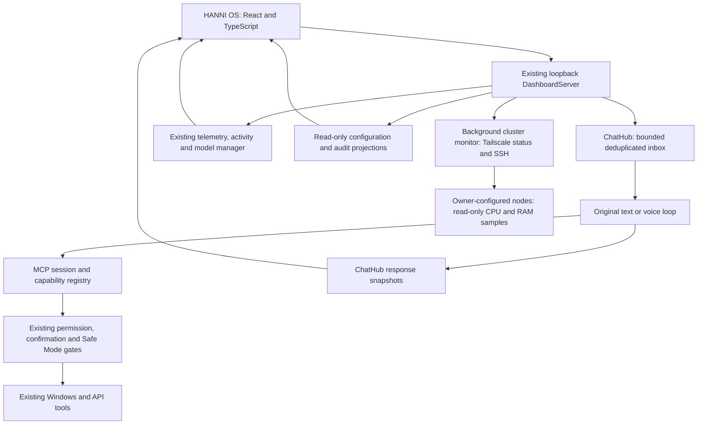

# HANNI OS desktop workspace

HANNI OS is a native Windows workspace for the existing HANNI assistant.
It includes Home, Conversation, Mission Control, Cluster and Settings. The original
launcher, foreground controller, capability registry, approvals and voice
session remain authoritative.

## Open the workspace

`START_HANNI.cmd` opens the native desktop client alongside the existing
foreground assistant launcher. Keep its terminal available for tool
confirmations. `-DashboardOnly` monitors without starting a model or microphone;
`-Text` uses keyboard conversation. `-NoBrowser` suppresses automatic desktop
launch for an explicitly managed client. The loopback browser interface remains
available for development and compatibility.

The built application is `dist/HANNI OS/HANNI OS.exe`. Launching it by itself
attaches to a verified running HANNI service or starts a dashboard-only monitor
from this repository. **Application > Start Assistant** explicitly starts the
original model/voice launcher in its permissions terminal. Closing the desktop
leaves a live assistant session running; only a monitor started by that client
is stopped on client exit. Tray preferences support optional close/minimize to
tray, notifications and saved window geometry. No model weights are bundled.
See the [desktop build/installation documentation](HANNI_DESKTOP.md) and
[independent review reports](desktop-reviews/iteration-0.md).

The native wrapper loads the existing loopback origin directly. No Node
installation, runtime CDN or new cloud service is required for normal use.
Compiled React assets remain packaged with the existing Python dashboard.

One compact sidebar switches screens and lists actual recent messages. On narrow
screens, a menu button opens it. Context is an optional overlay rather than a
second permanent sidebar. A small global voice strip expands for details;
the visual continues to use measured microphone level. UI preferences persist
in the native WebView profile; window/tray preferences persist separately.

`Ctrl+K` or `Cmd+K` opens workspace search. It searches screen names, registered
capability names and loaded conversation messages. Choosing a capability
prepares a question; it never executes that capability. This shortcut belongs
to the browser window, not a native Windows launcher. Escape dismisses search.

## Verified integration map



| Endpoint | Contract and source |
| --- | --- |
| `GET /api/chat` | Existing history, readiness, queue, per-launch token and epoch; `before` pages older history |
| `POST /api/chat` | Existing bounded inbox; UUID deduplication; processed by the original CLI loop |
| `POST /api/chat/clear` | Existing display-history deletion; blocked during queued/running work |
| `GET /api/state` | Existing psutil/device readings, model residency, scalar microphone activity, Safe Mode and interaction state |
| `GET /api/workspace` | New versioned, read-only projection of configured models, registered capability definitions and policies; no tool execution |
| `GET /api/activity` | New bounded projection of the existing tool audit; newest 30 parsed rows from at most 256 KiB |
| `GET /api/cluster` | Fixed nine-member roster, network availability and measured CPU/RAM history; starts one shared background sampler |
| `POST /api/cluster/power` | Explicitly confirmed, deduplicated Sleep/Reboot requests for a fixed roster ID; existing SSH authorization and Safe Mode checks |
| `POST /api/cluster/terminal` | Deduplicated `{id, node}` request opens a native interactive SSH terminal for a fixed roster ID; Windows host, token and Safe Mode checks |
| `GET/POST /api/audio-devices` | Existing validated local device enumeration and saved routing |
| `GET/POST /api/gpu-routing` | Existing detected GPUs and validated saved model routing |
| `POST /api/shutdown` | Existing launcher shutdown event; completes current work and stops owned processes |

All routes retain Host, Origin and cross-site checks. Writes still require the
per-launch token, matching Origin and a bounded JSON body. There is no generic
tool-execution endpoint. Only the original controller can decide to execute a
tool. Registered capability metadata does not imply permission to run it.

Live replies use the existing HTTP snapshots every 600 ms; activity and
telemetry use independent read polling. No new event bus, WebSocket or SSE
service was added. Reconnection reads snapshots and never automatically
reposts a command. A failed send retains its UUID for an explicit retry, and
the existing server deduplication prevents repeated actions.

The baseline before the adapter changes passed 685 tests with 2 skips and 17
subtests. Browser mutations are still consumed by `keyboard_inputs` or the
existing attentive voice path. Closing the UI never stops these paths.

## Cluster monitoring

The Cluster tab shows a compact overview of all nine members with member emojis,
availability, CPU/RAM percentages, uptime, sample age and small CPU histories.
Search by name/address, filter by status and sort by name, CPU, memory or uptime.
Unknown readings remain unavailable and sort below measured values.
Selecting a node opens its detailed CPU/RAM histories, memory capacity, observed
processes, OS/connection details, timestamps, diagnostics and real node controls.
Back to nodes restores the selected row's keyboard focus. Observed processes are
measured activity, not inferred tasks or
model-generated descriptions; command arguments, users and file contents are
not collected. Linux process CPU uses 100% for one core, so a multithreaded
process can exceed 100%; the system CPU graph stays on a 0–100% scale.
The list includes HANNI, Wonyoung, Haerin, Chaewon, Minju, Wonhee,
Jeongyeon, Karina and Yunjin. Small screens wrap rows and allow scrolling.
Yunjin uses a jellyfish emoji and stays **Under repair**, with no
address guessed and no connection attempts.

Each node's detail view also has an **SSH Terminal** button. It opens a separate Windows
Terminal window, falling back to a visible PowerShell console when Windows
Terminal is unavailable. The command uses the member's supplied SSH username,
not the root account used for authorized power controls. Advertised Tailscale
SSH uses the installed `tailscale ssh` wrapper; a detected LAN fallback uses
OpenSSH. Interactive login and host-key prompts appear in that window. The
button reports that the terminal was opened, not that authentication succeeded.
See [Windows Terminal command-line options](https://learn.microsoft.com/en-us/windows/terminal/command-line-arguments)
for the native window launcher.

Terminal launch is available even when resource readings are missing, allowing
connection troubleshooting. Yunjin remains disabled until her connection is
configured. Requests contain only a UUID and fixed roster ID; the browser cannot
supply addresses, usernames or commands. Duplicate IDs open one window, and
Safe Mode or launcher shutdown blocks new launches. User-opened terminals remain
open when HANNI stops. Nothing automatically retries a failed terminal request.

The monitor reads the existing local `tailscale status --json`, projecting only
the supplied nodes' presence, operating system and whether Tailscale SSH is
advertised. It connects to each supplied Tailscale address first, falling back
to the supplied LAN address when TCP port 22 is unreachable over Tailscale.
For nodes advertising Tailscale SSH, it uses the installed `tailscale ssh`
wrapper, which verifies host keys against the coordination server and uses
the owner's existing tailnet SSH policy. See the official [Tailscale CLI SSH
reference](https://tailscale.com/docs/reference/tailscale-cli#ssh). Otherwise
it uses OpenSSH with this account's existing agent/config/verified host keys.
Both paths use batch mode, strict host-key checking and bounded timeouts.
An optional `HANNI_CLUSTER_SSH_IDENTITY` points to an existing authorized key;
the key is never read or returned by the dashboard.

Sampling starts when the Cluster endpoint is first opened and uses one
persistent SSH telemetry connection per active node, shared across browser
tabs. The collector emits a sample every second and the UI reads its cached
snapshot every second. Each node retains the latest 60 samples (one minute)
in memory. Switching screens preserves this history; restarting HANNI clears
it. Linux readings use the Python standard library already installed on all
eight supplied nodes, one-second deltas from `/proc/stat` and process counters,
`MemAvailable` from `/proc/meminfo`, and uptime from `/proc/uptime`. Windows
uses native CIM CPU/memory/process counters and the OS boot timestamp.
Tailscale peer metadata is refreshed separately every ten seconds; healthy
SSH streams supply per-node availability every second. A slow or disconnected
node cannot hold up the others. Failed streams reconnect with a three-second
backoff; stalled streams and owned SSH processes are closed on shutdown.
Network delays can affect arrival times, which are shown per node.
No software, remote agent, configuration or keys are installed on
the nodes. The fixed collector only reads system counters, not user files.

Availability and readings are separate: **Online** can mean Tailscale presence
even if SSH access is unavailable, **Reachable** means only TCP port 22 was
reached, and **Unreachable** means the probes failed without a current
Tailscale offline report. Failed samples show **Unavailable**, not zero.
History has gaps for missed samples; status/readings become visibly stale
on lost dashboard connections. The graphs use real timestamps and a fixed
0–100% scale. There is no browser-supplied hostname or command endpoint.
The roster is declared in
`src/hanni/dashboard/cluster.py`; update Yunjin's addresses and maintenance
flag there once she returns, then restart the launcher.

Each node has **Sleep** and **Reboot** buttons. A native dialog names the node
and explains the effect; Cancel or Escape sends nothing. Controls stay disabled
for repair, stale/offline, unsupported or unauthorized nodes. Power support is
checked independently of telemetry using read-only login1 `CanReboot` and
`CanSuspend` calls. The owner’s current Tailscale SSH policy already authorizes
root access to all eight active nodes; the power path uses that existing grant,
with host keys still verified by Tailscale. Without that grant, a regular SSH
account can use an existing direct permission or narrowly permitted noninteractive
sudo command. No SSH, sudo or polkit permission rules are changed or installed.
Current read-only checks report Sleep unavailable on HANNI; its button explains
that limitation. Yunjin remains disabled while under repair.

The server accepts only a UUID, roster ID, `sleep`/`reboot`, and `confirmed:true`.
The existing same-origin/per-launch-token protections apply, as do persisted
Safe Mode and launcher-shutdown checks. Commands are fixed systemctl calls,
with noninteractive authorization and active inhibitors respected; there is
no force option. See the official [systemctl command reference](https://github.com/systemd/systemd/blob/main/man/systemctl.xml).
An accepted request means the OS acknowledged it, not that a reboot completed.
Disconnects/timeouts show an unknown outcome, retain the request ID and never
automatically resend. A per-node reservation and 60-second cooldown prevent
duplicate or overlapping successful/uncertain requests across tabs. The last
request/result is shown in its row and kept in memory for the launcher session.
Sleeping nodes may need physical access to wake; no remote wake is implemented.
Power controls currently support the cluster's Linux nodes; other OSes remain
disabled until a supported power adapter is added.

## Real data and unavailable features

Model names, roles and capability counts come from the backend. Hardware
readings come from the original telemetry sources. GPU fallback readings are
labeled estimated, and missing temperature/utilization are unavailable.
Old samples remain visible with an explicit stale-reading notice on a lost
connection. No demo records are bundled into runtime screens.

The audio indicator changes shape only from measured microphone amplitude.
Speech playback has a textual state; the backend does not publish output
audio amplitude, so speaking does not produce an invented waveform. Reduced
motion starts the visual paused. Pausing freezes the shape while the measured
meter continues updating. The webpage never requests microphone or screen
capture permissions. Device selections take effect on the next voice start.

Tool details show recorded arguments, status, summary and duration. The adapter
projects known fields, reapplies private Google/task/content filtering and
redacts registered/token-shaped secrets and credential keys. No raw tool result
data or unfiltered log download is exposed. Audit entries are session-wide;
the existing audit has no chat-turn correlation ID, so the UI does not claim
per-turn traces, hidden reasoning or an approval queue. Tool approvals continue
through the original conversation prompts and controller. The dialogs for
clearing history and stopping the session only confirm existing UI operations.

Planner, memory browsing, attachments, screen awareness, registered agents,
agent/cluster job controls, inference throughput, benchmark browsing and HANNI Mini are
unavailable in this release. The existing assistant can still answer calendar,
task, file and memory requests through its normal capabilities. No new
productivity database, autonomous worker or screen capture path was introduced.
Cluster telemetry only reads the owner's supplied machines. Power changes
require the separate, explicit confirmation described above.

## Frontend development and packaging

Source is in `frontend/`; compiled assets are in
`src/hanni/dashboard/static/{index.html,app.js,style.css}`. Build dependencies
are locked in `frontend/package-lock.json`. React, the fonts available on the
local computer, styles and charts work without runtime CDN requests.

```powershell
npm ci --prefix frontend
npm run build --prefix frontend
.\.venv\Scripts\python.exe -m pytest
.\.venv\Scripts\python.exe -m hanni.evals.routing --json data\hanni-os-routing.json --coverage data\hanni-os-coverage.json
```

The browser build uses the [React root API](https://react.dev/reference/react-dom/client/createRoot)
and [Vite production bundling](https://vite.dev/guide/backend-integration.html).
The styles and SVG/canvas charts are custom; there is no UI kit, remote font,
decorative gradient, glowing border or scroll-reveal animation. The supplied
dark palette is the sole color scheme. No untested theme toggle is included.

Source exports and source distributions include the TypeScript application and
lockfile, excluding `node_modules`. Python wheels include the compiled assets;
the normal Python setup/launcher does not invoke npm.

## Browser verification

The smoke test uses synthetic local/cluster telemetry and an in-memory ChatHub. Its settings
requests are intercepted and recorded; it performs no real tool executions,
device changes, model downloads or microphone capture. It exercises the actual
packaged HTML, bundle, local chat endpoints and read-only gateway routes.
Its cluster collector is injected; browser tests never contact real nodes.
Terminal launches are injected and recorded too; these checks open no native
terminal windows or SSH sessions.

```powershell
.\.venv\Scripts\python.exe -m pip install playwright
.\.venv\Scripts\python.exe scripts\check_hanni_os_browser.py
```

Chrome is the default. For a Playwright browser, install Chromium and pass
`--channel chromium`. Screenshots and the result report are written to the
ignored `data/hanni-os-review/` directory. Checks cover all five screens at 12
widths from 320 to 1920 pixels, plain-text rendering, streamed reply skeletons,
history, command search, device settings, reduced motion, disconnect/recovery,
retained drafts, inspector persistence, redacted audit details and shutdown
confirmation, cluster graphs/status, scrolling, repair state and stale-reading
recovery. Live model/voice validation still requires the owner's running
model, microphone and speaker.

The initial cluster version passed 711 tests, 2 skips and 17 subtests.
The one-second telemetry and uptime/activity update passed 713 tests, 2 skips
and 17 subtests, including persistent connection cleanup and workload filtering.
The confirmed power-control update passed 730 tests, 2 skips and 17 subtests.
The native SSH-terminal update passed 744 tests with 2 skips. Its launch tests
cover fixed destinations, member usernames, literal path quoting, concurrent
deduplication, the PowerShell fallback, launch errors and route access checks.
Browser checks verified terminal requests and Yunjin's disabled button across
the same 12 widths; no native windows or real SSH sessions were launched.
Browser checks passed for all five screens at 12 widths, including power dialog
Cancel/Escape, disabled nodes and accepted/failed simulated requests. Read-only
capability checks verified reboot access on all eight active nodes and sleep
support on seven; HANNI reports sleep unavailable. No live power action was
executed during validation; dispatch, failure and timeout behavior use mocks.
A subsequent live check of persistent telemetry measured 1.00–1.01-second
sample intervals from all eight active nodes, including uptime and process
activity; Yunjin remained unprobed under repair.
The five-screen browser check covers all 12 widths. Its synthetic
cluster fixture also exercises missing readings and connection recovery.
The original v0.1 1,131-case routing benchmark passed 1,129 cases (99.82%). The browser reported
no JavaScript errors, external network requests or content-security violations.
Wheel and source builds included the gateway, compiled frontend, source/lockfile
and bundled React license notices. The distribution scanner still flags two
wheel patterns and eight source patterns; all were verified against the prior
repository or supplied Laya patch and predate this interface change.
