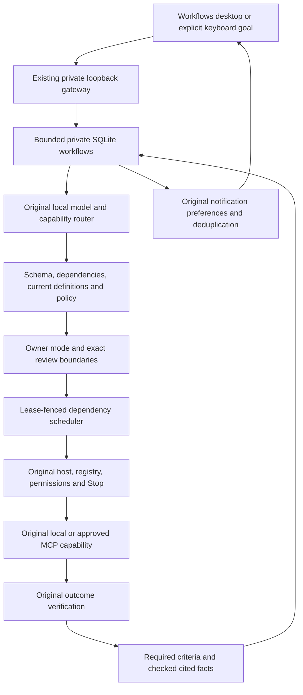

# Local workflows

V3 extends the existing HANNI controller, local model client, MCP host and capability registry. A workflow is private execution context, separate from permanent memory. Its SQLite record contains a bounded goal, validated dependency plan, approvals, invocation boundaries, verification and checkpoint history. A saved plan never grants tool permission.



The scheduler records the invocation before entering a handler and commits its receipt and verification under the same current ownership fence. Planning and analysis use the attached original model client. Model output supplies data for validation; it cannot select the actor, grant approval or change the owner-selected mode.

## Backend and desktop lifecycle

The existing dashboard backend and native desktop window are independent processes. Closing the window leaves an independently running backend available. Stopping the backend prevents new admissions and preserves unfinished records for recovery. A stopped, sleeping or powered-off computer performs no workflow work. There is no newly installed Windows service, autostart task, cloud runner or remote cluster executor.

For a backend without voice capture or interactive terminal input, use the existing launcher:

```powershell
.\.venv\Scripts\python.exe -m hanni.dashboard.launcher --workflow-only --no-browser
```

Keep that terminal running. In another terminal, run `.\START_HANNI_OS.cmd -AttachOnly` and open Workspace → Workflows.

This uses the original registry and configured local model. Existing model startup and resource policy still apply. `--reuse-model` requires a healthy, user-verified existing endpoint; it does not adopt that server as an owned process. `--dashboard-only` is a history/monitor view without an attached execution controller. The two modes are mutually exclusive. Ctrl+C stops the owned backend. Opening Workflows does not start a model or request access to providers.

In the existing keyboard session, `/goal <objective>` submits an explicit persistent goal to this same attached service, and `/workflows` lists bounded saved status. Ordinary conversation keeps its existing behavior. The Workflows view provides plan/action review and controls.

## Authorization and operating limits

- Assisted proposes a plan for explicit review before execution.
- Supervised admits authorized low-risk steps; sensitive actions need exact action approval.
- Background requires an approved workflow scope and all original tool background permissions. A previously approved plan does not override current actor permissions, emergency stop, disabled MCP tools or changed definitions.

Workflow controls use the existing authenticated loopback dashboard. The only new write endpoint is `/api/workflows`, accepting a UUID, a fixed operation and operation-specific data. History and detail routes require the same private dashboard token. There is no generic tool, shell, credential, arbitrary file-opening or remote execution endpoint.

Configuration is the `workflows` section of `config/hanni.yaml`. Defaults are 16 steps, two concurrent reads, two active workflows, one safe retry, 30 seconds per tool admission, 600 seconds per workflow, 120 seconds planning, two planning attempts, 300 seconds approval validity and 32 capability invocations. Goal/plan/results/artifacts and record retention are bounded. Configuration cannot raise the hard implementation caps.

Settled private workflow context expires after the configured retention interval, thirty days by default. Uncertain effects and live approvals remain available for review. Durable request fingerprints survive as expired response tombstones, preventing an old request from recreating prior actions. Expired private artifacts are queued for bounded cleanup only inside managed workflow-ID directories. Links/junctions and locked files retain a pending queue. The artifact budget applies to the shared managed root, including retained cleanup work.

CPU/RAM scheduling evidence comes from the existing cached telemetry worker. Missing/stale RAM telemetry and critical RAM pressure prevent admission. The original model inference lease retains its RAM/VRAM policy. Unknown GPU readings are unavailable evidence, never assumed free VRAM. These are admission limits, not kernel CPU/GPU throttling. Capability invocation budgets are not claims about the exact number of HTTP requests inside a provider adapter.

Supervised automatic scope covers validated known local reads and checked analysis. Imported MCP tools are not silently admitted under that scope. A sensitive supervised managed-artifact write also waits for its exact action review. Foreground conversation and emergency Stop take precedence over further workflow admissions. Clearing Stop does not itself resume a withdrawn workflow.

Saved workflow context is not automatically promoted to long-term memory. A memory capability remains a consequential original tool action, subject to its original permissions and exact workflow review. Notifications carry bounded status and workflow identity rather than source-file contents. Results and output excerpts remain behind the private gateway; artifacts expose saved text and scoped metadata, not an arbitrary opener.

## Recovery and verification

Consequential dispatch must have a durable invocation boundary before the original tool is called. Completed verified steps are retained. Cross-process ownership uses a lease and fencing rather than an in-memory flag. After a crash, an unresolved write needs reconciliation or review; missing acknowledgment never authorizes replay. Only explicitly classified safe reads can be retried within the bounded budget.

Pause/cancel/timeouts stop new work at safe boundaries. A synchronous external handler may continue until it returns. The interface must show that pending state rather than claim successful termination. Revoking an unused approval does not undo a completed action. Changed plan, arguments, schema/definition or expired approval requires fresh review.

Explicit renewal of an expired or revoked scope creates a fresh pending plan review. Reviewing and starting it preserves completed verified steps and the original duration deadline. A changed unfinished tool binding requires a new goal/plan. An uncertain write remains blocked for investigation; this version provides no automatic replay or force-reconciliation button.

An invocation, a successful tool receipt and a verified outcome are distinct records. Each required step needs its acceptance evidence before the goal is complete. Remote MCP self-reported success is insufficient independent evidence. A file hash proves bytes at a scoped path; it does not prove that a report's analysis is correct. Unsupported benchmark execution, screen analysis and hardware/provider features remain blocked or untested where the current registry lacks the required capability.

Verified analysis is bounded structured observations and deterministic value, count, sum, difference, ratio and percentage calculations from declared verified prerequisites. The implementation checks cited values and arithmetic, then generates its saved report text. It does not verify free-form causal explanations, historical claims, source completeness or benchmark scores absent actual supporting capability evidence. Unsupported work cannot become a verified completion by replacing it with a plausible report.

## Development and independent evaluation

[The V3 report](WORKFLOWS_V3_REPORT.md) records implementation, independent results, measured performance and the current planning-quality blocker. [Checkpoints](WORKFLOWS_V3_CHECKPOINTS.md) preserve milestone acceptance and failed cycles. [The independent baseline](v3-reviews/m0-baseline.md) records the original 44 practical assertions and their actual denominators. Public development fixtures are distinct from the original eighteen consumed planning cases and the separately sealed new nineteen-case assessment. Scripted model fixtures prove execution engineering, not natural-language planning intelligence. Real model, process-crash and native desktop measurements identify their source/configuration and limitations in the report. Original model/permission interfaces remain authoritative; experimental goal planning cannot grant itself permission.

Reproduce the exposed execution, recovery and security checks against isolated stores:

```powershell
.\.venv\Scripts\python.exe -m pytest tests/integration/test_workflow_service_verifier.py tests/integration/test_workflow_service_process_verifier.py tests/integration/test_workflow_service_security_verifier.py tests/integration/test_workflow_imported_parallel_verifier.py
```

The real-process suspension case requires Windows. Scripted planning and resource probes are stated fixture seams; original routing, permissions, private SQLite, SDK transports and local effects remain real. Expected refusal/failure cases are never added to the positive-objective completion denominator. The public browser runner lives in `scripts/v3_review/check_browser.py`; its source documents fixture-only authorization and cleanup boundaries. Its actual interactions do not replace native pixel review or configured-model evaluation.

Future capability work should enter the original registry/MCP discovery and verification contracts. Screen understanding needs an actual bounded vision capability and independent evidence before a goal can claim to analyze a screen. Benchmark goals need a real approved runner and original score artifacts. Cluster execution needs explicit per-node authority, resource and identity boundaries; current local scheduler ownership is not a distributed lease. Additional reconciliation should prove effect identity before offering any uncertain-action decision. None of those future interfaces grants new execution authority in this version.
