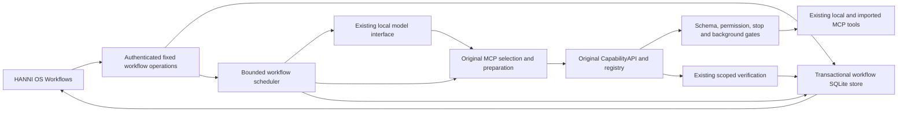

# HANNI V3 implementation checkpoints

## M0: baseline and architecture audit

Baseline source: `aa50409b0002cb66b799bf6824431131b8d9d708`. Independent evidence: [M0 report](v3-reviews/m0-baseline.md). Fresh regression: 1,057 passing tests, 17 passing subtests, two existing skips; frontend type check passed. Practical assertions: 44/44; independently checked positive outcomes: 18/18; application-recorded VERIFIED scopes: 16/18. Four genuine local diagnostic reads passed. This does not establish the 95% autonomous completion target. No foundational unsafe failure was observed.

The current CLI/TextSession owns inference and conversational execution. The capability registry, CapabilityAPI, MCP host and permission manager own selection, schema validation, scope, confirmation and execution. Reliability V2 records scoped verification; its traces do not authorize replay. The MCP Hub imports dynamic capabilities into this same registry. Memory retains its existing consent and storage boundaries. The desktop frontend uses authenticated loopback APIs and the existing workspace/notification stores.

There is no active workflow scheduler or durable DAG. The legacy jobs facade expects an absent manager. The desktop window already runs independently of its backend process. A workflow service will attach to that original backend/controller rather than introduce a replacement controller or Windows service.

Worker 1 owns the workflow package, narrow original-host preparation integration and backend tests. Worker 2 owns workflow frontend components. The independent verifier owns evaluations and review scripts, including eighteen newly sealed planning cases. The coordinator owns configuration, lifecycle, dashboard/CLI integration, packaging and checkpoints. Exactly three actual subagents are reused.

Remaining: M1 durable state; M2 capability-aware planning; M3 gated execution; M4 recovery/fencing; M5 bounded autonomy; M6 acceptance evidence; M7 interface; M8 independent security, crash, model and native evaluation. Resume at M1. User/provider data and node power are excluded from evaluation; unsupported benchmark execution and screen/voice features must remain truthful limitations. No remote publication or model replacement is authorized.

## M1 cycle 1: durable store, independent verification failed

Implemented bounded workflow types/configuration and lazy private SQLite state, durable UUID replay, exact plan/approval hashes, invocation boundaries, lease fencing and crash recovery. Files: `src/hanni/workflows/{types,store,__init__}.py`, configuration schema/loader, package registration and `config/hanni.yaml`. Root and worker persistence/configuration tests passed; independent verifier ran ten additional cases with **seven passing and three failing**. Independent owned subprocess crashes before dispatch/after a simulated external effect and two-process live lease arbitration passed.

Blocking defects: a nested short generic `token` value could persist; recovery of a later read overwrote an earlier uncertain write's BLOCKED status; altered version-one column schemas reached WAL setup before rejection and modified header bytes. Independent tests: `tests/integration/test_workflow_store_verifier.py`; evidence: `data/hanni-v3-review/m1-independent-cycle-1.xml`. This checkpoint records a failed implementation/verification cycle, not accepted persistence. M2 is held until all three are corrected and independently rerun. Hard record/operation caps are present; age-based cleanup is not yet implemented. Resume at M1 repairs.

## M1 cycle 2: repaired durable boundaries

The independent verifier reran the same ten frozen oracles: **10/10 PASS**, with unchanged test SHA and evidence `data/hanni-v3-review/m1-independent-cycle-2.xml`. Short generic token fields are rejected, recovery aggregates workflow uncertainty, and complete schema identity is checked before changing journal mode. Worker persistence tests: 26 PASS. Original pre-dispatch/after-effect process-crash and two-process ownership assertions remain passing. This accepts the measured M1 storage boundaries; no engine, model planning or native autonomy is claimed yet.

A separate depth-650 malformed-JSON probe found an uncaught recursion exception before private persistence. No credential was written and no permission was bypassed. M2 must add depth/element bounds before recursive privacy checks before accepting model/MCP payloads. Age-based retention is still pending; current hard caps preserve unresolved records and replay IDs. Resume at M2 planning and input hardening, then gated execution/recovery/background/verification/UI milestones.

## Integration draft cycle 1: controller cleanup failures

The coordinator wired private fixed workflow routes, original-controller attachment, explicit keyboard goal commands and an optional workflow-only mode in the existing launcher. These are integration drafts awaiting the service implementation. Independent HTTP review denied all thirteen unauthorized private reads and eight mutation/path requests before lookup or execution. Fault injection produced **two passing and three failing** facade/lifecycle cases: failed replacement and detach kept an obsolete attachment identity, and a detach exception skipped original session cleanup. Evidence: `data/hanni-v3-review/facade-independent-expanded-cycle-1.xml`; tests: `tests/integration/test_workflow_facade_verifier.py`.

This is a failed integration-cycle checkpoint, not M3/M5/M7 acceptance. Root must clear facade admission before fallible detach/replacement and preserve original cleanup in its failure paths, then independently rerun the same tests. No live workflow execution or model outcome is claimed. Resume at bounded integration repairs while Worker 1 implements M2.

## Integration draft cycle 2: lifecycle fault paths repaired

Independent rerun: **5/5 unchanged facade oracles PASS**, including all 21 HTTP denials and three lifecycle faults. Report: `docs/v3-reviews/facade-independent-cycle-2.md`; JUnit: `data/hanni-v3-review/facade-independent-cycle-2.xml`. Facade identity/admission now clears before a fallible detach; replacement failures retain no obsolete controller identity. Workflow cleanup exceptions cannot skip original session, model or server teardown. Root targeted original/independent integration tests: 52 PASS, plus the added server-resource cleanup fault test PASS. Failed-cycle evidence remains retained.

Files changed: dashboard workflow facade/server/launcher, CLI cleanup and root integration tests. The actual workflow service, model planning and native interface are still pending, so this accepts only integration boundaries. Resume at M2, with persistence depth hardening still required before model-result admission.

## M2 cycle 1: planner and boundaries, application resolution failed

Implemented two-pass structured planning through the existing client and original host routing, compiled exact schema/policy/argument hashes, typed prerequisite references, analysis evidence criteria, bounded JSON depth/nodes and crash-spanning retry ceilings/backoff. Original host `prepare_call` remains the argument/scope authority; its additive trusted workflow path uses the original CapabilityAPI/registry. An optional request definition hash is checked against the definition actually captured by the original registry before handler entry; a replacement between host preparation and dispatch is denied. Defaults and ordinary interactive tool calls retain their behavior.

Files: workflow planner/policy/references/types/store, original MCP host, original ToolRequest gate and development tests. Worker checks: 99 PASS before the final captured-definition addition; a further 61 planner/original-MCP checks passed afterward. Root captured-definition race and original-call checks: 2 PASS. Independent initial planner/persistence boundary suite: **34/34 PASS**, including the expanded twelve persistence checks. Independent application-resolution additions expanded this to **34/36, FAIL**: a local file shadowing a safe alias and an uninspected shortcut could still pass workflow policy, while the original Windows handler prefers those paths over alias launch.

Report: `docs/v3-reviews/m2-independent-cycle-1.md`; evidence: `data/hanni-v3-review/m2-independent-expanded-cycle-1.xml`. No model was started, no handler/app/script was launched by these planner cases, and no unseen planning score is claimed. The M1 recursion robustness defect is now repaired and independently accepted. Hold M3 until workflow-only application target admission is corrected and the unchanged expanded planner oracles pass. Resume at M2 application-resolution repair; do not weaken ordinary interactive behavior or permission gates.

## Maintenance foundation cycle 1: private retention boundaries verified

The coordinator implemented age-based private context expiry in `workflows/maintenance.py`, preserving unsettled invocations/live approvals and every durable UUID/fingerprint. Expired API responses become replay tombstones; they cannot recreate a prior goal or grant. Physical artifact cleanup uses a durable queue and derives only canonical generated workflow-ID folders under managed storage, with bounded unlink/rmdir and link/junction refusal. Fixed absolute boundaries are checked for each removal. Partial failure/crash keeps the queue.

Independent frozen-source run: **11/11 PASS**, comprising seven unit and four independent cases, including an actual isolated Windows parent junction, outside marker preservation, a live sibling, partial bounded cleanup and malformed queue identity. Evidence: `data/hanni-v3-review/maintenance-independent-cycle-1.xml`. Record and queue caps stay bounded. Runner integration, shared artifact budget, Safe Mode and foreground-priority admission are still required in M3/M5; history GET does not invoke maintenance. Resume with Worker 1's service integration after M2 acceptance.

## M2 cycle 2: protected application preparation accepted

Independent rerun: **36/36 unchanged planner/persistence oracles PASS**. Report: `docs/v3-reviews/m2-independent-cycle-2.md`; evidence: `data/hanni-v3-review/m2-independent-cycle-2.xml`. Both application-resolution failures are repaired. Workflow-only application preparation pins owner-requested original aliases to installed protected Windows system binaries, rejects working-directory shadows and uninspected shortcuts, and fixes the exact target before model binding and approval hashing. Ordinary interactive application resolution remains unchanged. Protected OS/Program Files writes are also refused by workflow policy.

Worker combined checks: 124 PASS, including the unchanged independent cases and original MCP/session regressions. A separately labeled protected-target preview passed using the installed Notepad binary with shortcut discovery stubbed; no application was launched. This accepts M2 preparation boundaries and prior depth hardening, not semantic planning or live workflow outcomes. The sealed eighteen planning cases remain unexecuted. Resume at M3 actual service/execution, followed by recovery, bounded autonomy, verification and native interface evaluation.

## Execution boundary cycle 1: callable binding replacement found

A further coordinator review reproduced a changed-handler dispatch when two functions came from the same factory with different closure targets. Their module/name/bytecode fingerprint was identical, so replacing the approved definition between original host validation and registry capture passed the hash gate. The actual original host, CapabilityAPI, registry and isolated file-read handler were used; no provider/application/node action ran. Root regression: **2 PASS, 1 FAIL**, evidence `data/hanni-v3-review/definition-binding-cycle-1.xml`; frozen new oracle: `tests/unit/test_workflow_registry_guard.py`.

This is an additional failed execution-boundary cycle, not acceptance of M3. Repair must bind the exact captured in-process definition at dispatch and distinguish trusted callable bindings during durable approval review, without serializing arbitrary closure data or weakening ordinary interactive calls. Independent review will include replacements before host validation and while waiting for the mutation lane. Resume at this bounded repair while service implementation continues; engine acceptance remains held.

## Outcome foundation cycle 1: contradictory prerequisite evidence failed review

Implemented deterministic required-step checks and bounded structured reports in `workflows/verification.py`, using original outcome verification and declared prerequisite citations. Quoted values and arithmetic are checked independently; saved report bytes cannot establish unsupported analysis. Root checks: 30 PASS. Independent checks using genuine isolated original `file.read`: **8 PASS, 4 FAIL**. Report: `docs/v3-reviews/outcome-independent-cycle-1.md`; evidence: `data/hanni-v3-review/outcome-independent-cycle-1.xml`.

The four failures are conservative-input/evidence defects: malformed prerequisite verification string/list escaped as AttributeError, and outer VERIFIED projections upgraded an underlying failed or unverified original result. These intentionally inconsistent in-memory projections demonstrate an evidence-integrity weakness, not an executed public API exploit. Preserve the twelve independent oracles and repair source-kind validation before M6 acceptance. Full service execution, sealed planning and native review remain pending. Resume at bounded prerequisite evidence repairs while engine smoke tests proceed.

## Binding and outcome foundation cycle 2: independent repairs accepted

Independent unchanged outcomes: **12/12 PASS**; independent unchanged callable replacement races: **3/3 PASS**. Evidence: `data/hanni-v3-review/outcome-and-binding-independent-cycle-2.xml`; reports: `docs/v3-reviews/outcome-independent-cycle-2.md` and `callable-binding-independent-cycle-1.md`. Exact captured definition checks and opaque registry-owned stateful binding IDs reject changed closures/instances, including after waiting for the original mutation lane. Separate two-process probes confirm stable original plain functions and invalidated reconstructed stateful bindings. No arbitrary closure data is serialized.

Outcome source validation now checks original execution and evidence instead of trusting contradictory outer projections; malformed input fails conservatively. Chained analysis rechecks bounded citation provenance and refuses cycles. Root outcome checks: 33 PASS, separately identified from independent cases. Original tools/MCP and workflow/notification checks: 138 PASS; frontend typecheck and sixteen workflow helper tests passed. Original notification storage preserves preferences and acknowledged-event deduplication across adapter restart.

Files: original tool/host policy bindings, workflow outcome verification and associated tests/reports. An additive original dispatch callback now permits live service lease/revocation checks after mutation-lane acquisition. Root follow-up checks additionally pass for original verification reads inheriting that guard and binding their checked read definition; focused original V2/follow-up regressions: 95 PASS. A known completed effect remains a receipt if its follow-up read cannot be authorized; it is never replayed to obtain verification. Actual service callback/recovery integration is still pending independent acceptance. Resume at M3 coherent service freeze and multi-step evaluation, then M4–M8. No real model or native score is claimed.

## M3 development draft: retry ordering defect retained

The worker's first combined 65-check development run exposed retry settlement occurring before persisted backoff elapsed. It was repaired generically before later smoke tests. No JUnit file or frozen source manifest was captured for that first run; its failure remains in tool history and is not assigned an invented pass denominator. Subsequent real original-registry development cycles passed 150 checks, then fifteen service cases and a combined 154 checks (`m3-development-cycle-1.xml`, `m3-development-cycle-2.xml`, `m3-development-modes.xml`, `m3-development-final.xml` under `data/hanni-v3-review`). These are implementation-owned development results, not independent M3 acceptance.

The actual service now exists with fixed controls, DAG dispatch, checkpoints, scope and callback guards, original verification, safe retries and retained synchronous cancellation state. Source review found additional pre-freeze requirements: managed-parent junction admission, oldest eligible work beyond recent-history limits, meaningful supervised mode, Stop persistence, private notification-cache bounds and fresh review of expired authority. The worker is tightening these before independent service execution. Resume at that coherent freeze; maintain all failed-cycle evidence and the sealed planning-case boundary.

## M3 implementation freeze: ready for independent execution

The coherent service implementation and its development evidence are recorded in `docs/v3-reviews/m3-implementation-freeze.md`. The final combined development run passed 157 checks, followed by sixteen service checks after the last model-entry admission guard. Production source is frozen for independent evaluation. These overlapping development runs are not summed into a reliability denominator. The report retains the earlier retry-ordering failure and a corrected test-call signature failure separately.

Files: `workflows/service.py`, store/types/planner exports and `test_workflow_service.py`. Internal admission now selects bounded oldest nonterminal work; owner-selected Supervised runs only validated known local low-risk work automatically. Assisted and Background retain exact plan review, while sensitive supervised writes require exact action review. Stop persists withdrawal requests, original callbacks recheck current authority, unsafe managed parent links/reparse points are refused, and explicit scope renewal preserves completed steps and the original duration budget. Config/facade/original launcher tests: 80 PASS; coherent frontend production build passed.

Independent service, crash, security, browser and final native/model evaluation are still pending. Resume at the frozen-source independent M3–M6 checks and retain any failures before repairs. No live provider/node/application/voice action or production assistant start is claimed.

## Browser integration cycle 1: verification clock isolation failed

The actual original dashboard/service browser harness passed 22 assertions before failing its subsequent restored-review case. Evidence: `data/hanni-v3-review/browser-cycle-1/browser-review.json` and retained debug screenshot. Source diagnosis found the verification harness advanced a BrowserContext-wide clock, affecting its sibling pages; the main review therefore correctly remained expired. No application source defect was identified in that failure.

This is a failed browser evaluation cycle, not M7 acceptance or a native visual score. Preserve all existing review/expiry/POST/hash oracles and isolate the browser-only expiry clock in its own context, with the same real server/token/approval and bounded cleanup. Resume at the harness isolation repair and rerun, while independent backend cases continue. The compiled bundle and private APIs are real; model replies/resources remain disclosed fixtures.

## Browser integration cycle 2: completion assertion requires diagnosis

The corrected isolated expiry clock and actual second-window stale-plan guard passed. The second actual browser run retained 24 passing assertions before its compound read-workflow completion assertion failed. Evidence: `data/hanni-v3-review/browser-cycle-2/browser-review.json`. Production source and compiled bundle were unchanged. No application defect or passing completion is inferred from the compound assertion; add diagnostic status/count/evidence/source-byte values ahead of the unchanged assertion and repeat in a fresh cycle. Preserve both failed browser runs. Resume at that bounded diagnosis; M7 and native visual acceptance remain pending.

## Background launcher integration: actual original path accepted

One coordinator-owned integration test passed using the actual `--workflow-only` launcher, original session/registry/host attachment, private authenticated HTTP goal submission, SQLite service, local file read and outcome verification. A supervised local read completed once, while the backend shutdown event remained unset and its original controller remained attached. Explicit teardown then closed the workflow facade, original model manager seam, telemetry seam and real server socket. Evidence: `data/hanni-v3-review/workflow-only-launcher-cycle-1.xml`; file: `tests/integration/test_workflow_only_launcher.py`.

Only structured model replies, model-manager startup and RAM telemetry are fixtures in this check. It proves the launcher integration and backend lifetime, not configured-model intelligence, real GPU admission or native window-close survival. Those independent final checks remain required. Resume with frozen-service independent crash/security cases and the browser diagnosis.

## M3 independent cycle 1: task readback route omitted

The actual isolated original service passed 26 of 27 expanded engineering checks after two report newline assertions were corrected to the pre-existing Windows file-write contract. Initial failed artifacts remain retained. One genuine production limitation remains: the step description `Read back one local task by its exact ID.` routes only `todo.list`, omitting the registered `todo.get` needed by the unchanged three-step task-add/readback/report case. The service conservatively rejected planning; no task handler ran. Evidence: `data/hanni-v3-review/m3-independent-expanded-cycle-1.xml` and `m3-task-menu-cycle-1.json`; report: `docs/v3-reviews/m3-independent-cycle-1.md`.

Freeze acceptance remains FAIL. Repair the generic original readback routing relationship without bypassing the capability router, altering benchmark expectations or substituting an unrelated list operation. Keep the exact public goal and scripted capability bindings. Crash/process and expanded security checks continue separately; no real-model planning or native visual acceptance is inferred. Resume at this bounded retrieval repair and unchanged independent rerun.

## Browser integration cycle 3: asynchronous completion polling failed

The diagnostic third cycle preserved the unchanged completion assertion and found a still-running workflow, one dispatched original read capability and intact source bytes. The installed Playwright `wait_for_function` accepts a truthy Promise from the harness's asynchronous fetch predicate before actual completion. This affected the three authored async completion waits. Evidence: `data/hanni-v3-review/browser-cycle-3/browser-review.json`. No production UI/backend defect was established by that failure.

Preserve cycles 2 and 3; replace verification-only waiting with bounded awaited actual authenticated GET polling, retaining the same terminal-state and evidence assertions. No fabricated response or relaxed completion oracle is permitted. Resume at the harness waiting repair; visual scoring remains pending genuine native review.

## Browser integration cycle 4: original file-create retrieval omitted

The corrected awaited authenticated polling passed 31 checks, including actual original read completion and a genuine typed-reference managed artifact whose text, SHA and saved excerpt matched its source. The next sensitive action plan was conservatively blocked: the original routed menu returned no capability for `Create a local text file at <fixture path>`, despite the isolated original host's explicit `file.write` whitelist. The UI correctly exposed the unsupported required step and no plan approval. Evidence: `data/hanni-v3-review/browser-cycle-4/browser-review.json`; reports: `docs/v3-reviews/browser-cycle-2.md`, `browser-cycle-3.md`, `browser-cycle-4.md`.

This is a real original retrieval limitation, not a passing sensitive-action interaction. Its unchanged description and capability binding join the generic routing repair from independent M3 cycle 1. Remaining exact action approval/rejection/lost-response and cold/responsive checks were not reached. Resume at that coherent routing freeze and browser rerun; do not change the fixture wording to conceal the failure.

## M4 process recovery cycle 1: conservative write recovery accepted

Independent genuine process execution passed three unchanged recovery/fencing checks (`data/hanni-v3-review/m3-process-independent-cycle-1.xml`). Owned children exited after a committed invocation but before original handler entry, and after the original file-write effect/audit but before receipt commit. The first had no effect; the second had one exact effect. Restart recorded uncertainty and refused write resume/retry, with no duplicate original handler entry. An actual Windows-suspended owned child outlived its lease; a second service owner recovered conservatively, and the old completion could not overwrite that decision.

Files: `scripts/v3_review/service_process_probe.py` and `tests/integration/test_workflow_service_process_verifier.py`. Original handlers stayed unwrapped and restart-stable; no callable-binding bypass was used. These three cases accept those conservative recovery mechanisms, not universal exactly-once delivery or safe resumption of every provider/stateful tool. Remaining expanded security, full M3 acceptance, final model and native evaluation are still required. Resume at the frozen-source independent checks and narrow routing repair.

## M3 routing repair candidate: original menus preserved

The generic original-host repair is frozen at SHA256 `fef2f85c34625d4eae5f59cc055595ae30e21a158a821610386752568ef43ceb`. Files: `mcp/host.py`, `test_workflow_readback_routing.py` and `docs/v3-reviews/m3-routing-repair.md`. It admits strongly supported same-namespace precise reads and discovers explicitly whitelisted local reversible writes only with positive action intent and existing evidence bounds. Original resolver/menu/prototype and strong discovery precedence remain intact. No thresholds or public expectations changed; external imported actions do not enter the new fallback.

Development checks: 78 routing/retrieval/coverage checks and 42 original MCP/planner/registry checks passed. A paired unchanged 1,131-case routing corpus retained 1,129 strict passes and identical original menus/outcomes across all cases. These are overlapping retrieval/development results, not model intelligence or completed workflows. The unchanged independent service and browser cases are rerunning; acceptance remains pending. Resume at those actual outcomes and the additional audit of conservative imported-read parallel admission.

## M4 extended recovery: bounded safe reads accepted

Independent process cycle 2 passed **5/5** checks, retaining the original three write/fencing cases and adding actual safe-read interruption before dispatch and after result. Explicit owner resume admitted at most one bounded retry, preserved completed prerequisites and made no new model call. Separate denominators are unknown-write conservative recovery 2/2, stale-owner fencing 1/1 and safe-read recovery 2/2. Report: `docs/v3-reviews/m3-process-security-independent.md`; evidence: `m3-process-independent-cycle-2.xml`. These are scoped recovery results, not five completed goals. Uncertain writes and changed stateful bindings still require investigation/new review.

## M5 and M6 boundary cycle: authorization and verification limits accepted

The final extended independent security suite passed **11/11** original-Service checks (`m3-security-independent-expanded-cycle-2.xml`). It retains failed verification-only cycles of 5/7 and 10/11: invalid Stop enum/nonatomic fixture setup, then a barrier placed while the Service lock was held. Corrected fixtures keep the original no-cleanup/no-dispatch outcomes; the final barrier forwards the untouched authority and arguments into the actual host/registry.

Verified boundaries include case-alias write serialization, quiet authenticated GET, foreground and persisted Stop precedence, invocation/output/record limits, real SDK tool withdrawal, untrusted imported receipts remaining UNVERIFIED, no descendant artifacts from those receipts, exact scope expiry, explicit fresh review retaining verified work and original deadline, and controller detach before original dispatch. Report and manifest scopes are explicit; the original host routing repair ran concurrently while service/store/authority stayed frozen. Files: extended process probe/tests and `test_workflow_service_security_verifier.py`.

These scoped checks accept those implemented M5/M6 boundaries; broad final acceptance still requires unchanged public outcomes, the imported-read parallel audit, native interface review, original regressions and sealed configured-model evaluation. Resume at coherent execution/browser verification, then final M7/M8 freeze. No general intelligence, universal exactly-once guarantee or termination of synchronous handlers is claimed.

## Browser integration cycle 5: actual reviews pass, collapsed-step harness failed

With the repaired original host, the actual browser passed 39 assertions. Sensitive-file plan and action review now work through the original pipeline: exact prepared arguments and risk are shown, Escape grants nothing, rejection executes no write, and an accepted action whose response is lost reconciles to one original verified write. Pending plan revocation and its Escape boundary also passed.

The next safe-retry assertion searched inside a collapsed native step-details element. Its inaccessible button was correctly absent from the accessible locator. Evidence: `data/hanni-v3-review/browser-cycle-5/browser-review.json`; report: `docs/v3-reviews/browser-cycle-5.md`. Expand the actual selected step through its summary before the unchanged retry assertion and continue in a fresh cycle. No source/API state or expected retry result changes. Remaining retry/cancel/cold/responsive checks and independent native scoring remain pending; resume there while the imported-read parallel audit proceeds.

## M7 browser cycle 6: real workflow interface accepted

The coherent actual browser suite passed **60/60** assertions in about 13.45 seconds. Report: `docs/v3-reviews/browser-cycle-6.md`; evidence: `data/hanni-v3-review/browser-cycle-6/browser-review.json`. It exercised seven durable isolated goals through the real private gateway/service/original handlers: goal UUID replay after a lost response, plan/action review and exact bindings, one verified write after lost action acknowledgment, rejection/revocation, explicit bounded safe-read retry, pending action cancellation, original notification Inspect, saved text/artifacts/checkpoints/invocations, stale/expired/cold/error states, keyboard modality and twelve responsive widths. No JavaScript errors or nonlocal requests were recorded. Source manifests matched at start and finish.

Files: workflow frontend types/page/styles/helper tests, workspace navigation and notification inspection, original gateway/features/activity copy, compiled assets and `check_browser.py`. App SHA256 remains `a9f09e6e3ea93e00b1d825f525e4f9fe5b86e2a64dc337e978908379756e71a2`; style remains `76c1e4d5c353b93acf71f02cf40de00d11f03515aae2a3930e9f31d675333e4e`. Earlier five failed evaluation cycles and their limitations are retained. Scripted planning/RAM and fixture-only original file.write whitelist remain disclosed; 60 checks are not 60 completed goals or model intelligence.

This accepts the actual browser integration at that freeze, not the required independent native visual score or overall M8. A task-readback fingerprint defect and imported-read parallel audit remain open in independent backend review. Resume at those repairs, genuine native review above 8.5, original regressions and final sealed configured-model evaluation.

## M3 independent cycle 2: unstable callable hash and task timestamp found

The unchanged 27-case original-Service rerun remained **26 PASS, 1 FAIL** after routing repair (`m3-independent-cycle-2.xml`). The exact task-add handler entered once, but its original verification follow-up and required readback were conservatively blocked because the unchanged `todo.get` callable fingerprint changed during normal execution. Independent component snapshots isolate the change to `marshal.dumps(code)` bytes; registry binding UUID, schema, policy and description stayed identical. Evidence: `m3-callable-hash-drift-cycle-2.json` and `m3-task-outcome-cycle-2.json`.

The same actual original receipt reveals another defect: planned and prepared due time remains `2030-06-12T15:00:00-04:00`, while the original task parser stores `2026-10-10T00:00:00`. Course and other prepared fields remain intact. This is original date parsing, not a reviewed-argument override. Preserve the exact public task fields and independent actual stored-date oracle; do not bless the parser's substituted date through self-consistent readback.

Resume with a stable semantic callable-code fingerprint that retains exact live identity and stateful binding guards, and a bounded exact ISO date/time parser repair. Original callable replacement and crash/process oracles must remain unchanged and rerun. The imported-read parallel-admission audit is still pending independent proof. No full executor or configured-model acceptance is claimed from the browser pass.

## M3 imported-read parallel cycle 1: conservative admission failed

Independent actual SDK execution retained **1 PASS, 1 FAIL** (`m3-imported-parallel-expanded-cycle-1.xml`). A same-session provider serialized its own wire calls, concealing the scheduler behavior. Two approved read-annotated tools on distinct genuine SDK stdio sessions both entered their original provider handlers within about 0.2 seconds during one-second calls; two scheduler `read` workers were active, violating the conservative serial-admission oracle. Evidence: `m3-imported-cross-session-evidence-cycle-1.json`. Provider handlers, permission definitions and original transport were not substituted.

`is_read` is sufficient for existing permission semantics but does not independently establish that imported operations are safe for automatic parallelism. Preserve read/effect/approval/verification meanings and introduce a separate known-local parallel-read classification, excluding imported/external bindings and serializing unknown resources. Root accepts this as a genuine execution-safety defect, which blocks final acceptance until the unchanged two-session oracle and original safe-read parallel tests pass. Resume at that bounded scheduler repair; the eighteen sealed goals remain untouched and no live model/native score is claimed.

## M5 planning admission cycle 1: second inference ignored foreground priority

An independent actual-Service fixture returned a valid first outline and set the original interaction state to responding before returning. The planner still entered its binding inference while `response_in_progress=True`: two model-interface calls versus the unchanged conservative oracle of one. No tool entered; the workflow reached plan approval. Evidence: `m3-planning-admission-independent-cycle-1.xml` and `m3-between-model-pass-admission-cycle-1.json`; test: `test_workflow_planning_admission_verifier.py`.

This is admission of a later call, not a requirement to interrupt an already active inference. Recheck current controller/generation, Stop, foreground/resource admission and workflow withdrawal at each trusted planning call boundary. Preserve the original client/model manager and bounded attempt/deadline rules. Resume at that small integration repair and unchanged independent rerun; it joins the existing hash/date/parallel candidate before the next coherent freeze.

## Callable default-capture cycle 1: stale approved binding executed

Two additional coordinator-owned actual host/registry regressions failed (**0 PASS, 2 FAIL**, `default-binding-cycle-1.xml`). A handler factory captures its target in positional or keyword defaults rather than a closure. Registering a same-code handler with changed defaults before host validation currently reuses an empty stateful binding ID and the old reviewed hash, allowing the replacement read handler to enter. The live captured-object dispatch gate still works for replacements after preparation; these cases test the earlier durable review boundary.

Files: `test_workflow_registry_guard.py` adds two frozen original-pipeline oracles. The fixture returns only isolated labels, with no provider/filesystem side effect. Treat default-bound functions conservatively as stateful registrations, assign a fresh registry-owned binding identity and preserve original ordinary interactive behavior. No arbitrary captured/default values should be serialized. Resume at that small registry classification repair, independent unchanged callable review and the coherent hash/date/parallel/planning-admission candidate freeze. This genuine stale-binding defect blocks final acceptance until repaired.

## M3-M6 coherent boundary repair freeze

The candidate is recorded in `docs/v3-reviews/m3-bounded-boundary-repairs.md`. Files: workflow policy/service/planner, original `whenparse.py` and registry default-binding classification, four focused new unit test files, and the unchanged previously frozen root/independent oracles. Semantic implementation hashing removes unstable marshal references while preserving typed code semantics, full metadata and live/stateful binding checks. Exact ISO due dates retain date/time/offset and malformed timestamps fail. Known local reads retain parallel slots; imported/provider/unknown reads use a truthful exclusive serial-read slot. Every planning call now rechecks current admission, with locks released before inference.

Development evidence: 197 checks passed; after the last exclusive planning-slot change, a final scheduler cohort passed 57/57 and a fresh binding/date/planner cohort passed 142/142. These are overlapping suites, not additive workflow successes. The original public Service 27 cases and actual SDK parallel checks pass in development; independent acceptance is still pending. Root eight original registry guards passed, including both unchanged default-capture failure oracles after the two-line stateful registration fix. The report retains the worker's two test-fixture mistakes separately.

Resume at independent unchanged Service/security/process/callable/outcome and planning-admission reruns. On acceptance, run genuine native window interaction/pixel review above 8.5 and original full regressions before final source/config/assets freeze and the sealed configured-model evaluation. All production sources are now held frozen; no real model or native score has been claimed.

## M8 regression cycle 1: comparison policy mirror omitted

The original full regression run exposed `test_k2_challenger_profile_matches_production_except_model_identity`; its unchanged narrow diagnostic also failed (`final-profile-diagnostic.xml`). The new workflow section exists in primary `config/hanni.yaml` but was omitted from the comparison profile's otherwise identical `hanni.yaml`. Its original contract requires policy equality while model identities differ. The complete first failed run remains retained as `final-full-cycle-1.xml`; it started before the profile repair, so it is not frozen-source acceptance even if its other checks pass.

Mirror only the exact additive workflow policy into `config/profiles/k2-bakeoff/hanni.yaml`, preserving model identity, weights, sampling, benchmark inputs/answers and training files. Resume with the unchanged profile oracle, a fresh fully frozen original regression run, native review and final sealed model evaluation. Native capture is held until this configuration boundary is frozen.

## M3-M6 independent acceptance: unchanged final cohort passes

The independent coherent candidate passed **69/69** unchanged scoped checks with zero failures/skips (`m3-independent-final-cohort.xml`): 27 public Service checks, eleven extended security, five genuine process recovery/fencing, two genuine SDK imported-read serialization, one between-pass foreground admission, three independent callable replacement, twelve outcome integrity and eight original registry guards including both default-capture oracles. Seven positive core objectives completed with independent stored-field/file/fact checks; safety/refusal/failure checks are separate and are not counted as completed objectives.

Two additional actual child-process probes passed: plain original file-read binding remains restart-stable; a reconstructed stateful task-read binding invalidates old consent (`callable-restart-probe-final.json`). Known local reads retain actual safe parallel execution; original third-party reads serialize without falsely becoming writes. Strict ISO due-time, full prepared arguments and task field readback now match the unchanged oracle. Earlier failed cycles remain retained. This accepts the exercised M3-M6 implementation mechanisms at the coherent source freeze, not general planning intelligence, arbitrary provider recovery or universal exactly-once delivery.

The comparison policy repair passed its original unchanged oracle (`final-profile-cycle-2.xml`). Main and challenger hanni.yaml now match byte-for-byte, with the same additive workflow limits and no model/benchmark/training change. Frontend typecheck and all thirty original/new helper tests passed. Resume at independent genuine native review, a fresh full frozen regression run, offline distribution and the final sealed configured-model evaluation. No required user action is outstanding.

## M8 full regression cycle 1: 1,341 passes and two retained failures

The first full run finished with **1,341 PASS, 2 FAIL, 2 existing SKIP and 25 passing subtests**, 206.43 seconds (`final-full-cycle-1.xml`). One failure is the already repaired comparison-policy mirror. The other is the original dashboard-contract unit test's literal screen list, which predates the explicitly requested new Workflows screen. Original discovery still performs no execution; the new screen is real and browser-tested.

Update that unit contract by adding exactly the implemented `workflows` screen and checking its configuration availability. Preserve the no-execution, existing model/permission/feature and privacy assertions. This is an intentional interface-extension expectation update, not a workflow/benchmark answer change. The original positive, refusal, security and sealed planning oracles remain unchanged. Resume at the narrow dashboard/profile check and a fresh full run on unchanged production bytes. The current native configuration boundary is now frozen; genuine native capture may proceed independently.

## M8 full regression cycle 2 and offline distribution accepted

The fresh full regression run passed **1,345 tests and 25 subtests, with two existing skips**, in 208.17 seconds (`data/hanni-v3-review/final-full-cycle-2.xml`). The unchanged profile oracle and intentionally extended dashboard screen contract also passed their seven-check narrow rerun. Production bytes stayed frozen. The added independent three-step security cases extend coverage without replacing prior expectations. Frontend typecheck and all thirty helper tests passed.

An offline, dependency-free wheel build succeeded. All 172 packaged Python modules, including all nine workflow modules, match current source bytes; the packaged compiled frontend matches current assets. The wheel has no model weights, private SQLite stores, environment credentials or certificate bundles. Evidence: `data/hanni-v3-review/wheel-inspection.json`; wheel SHA256 `9826afc1eab56f54ac830a7034e2b2fb2c2efa7c91b802d2cbd79b8d03eac116`. This accepts distribution contents, not an untested fresh-machine install.

## M7 native cycle 1: missing test-request Origin rejected

Independent actual portable Win32 review completed **45 checks and 20 physical screenshots**, at four sizes and observed 120 DPI, before the test fixture's second-window approval POST was rejected with HTTP 403. The request omitted Origin; the original private gateway correctly denied it before mutation. Report: `docs/v3-reviews/m7-native-cycle-1.md`; retained evidence: `data/hanni-v3-review/native-cycle-1/results.json`. Source/config/artifact identities matched and all owned windows closed. No production defect or completed visual/lifecycle acceptance is inferred; score remains NOT SCORED.

Checkpoint this failed cycle before a verification-only correction: supply the exact fixture Origin and safe stage diagnostics, keep the original functional/content/pixel expectations, and rerun the complete native matrix. After independent native acceptance above 8.5, freeze production/config/assets and evaluate the eighteen sealed configured-model goals once. No required user action remains; production HANNI remains stopped.

## M8 original practical before/after acceptance

Root's final unchanged practical rerun passed the original **40/40 controlled workflows plus 4/4 runtime/cluster boundaries**, preserving all stage outcomes and fully verified classifications. Independent positive outcomes remain 18/18; original application-recorded fully verified positive scopes remain 16/18 (88.9%). No expectation or verification upgrade was made to reach 95%. Original runner and fixture hashes match M0. Report: `docs/v3-reviews/m8-original-practical-comparison.md`; data: `final-practical-comparison.json` and original/final raw reports.

User-facing documentation now includes the separate execution-backend and attach-only desktop commands, current eighteen-screen navigation and the Workflows entry. Files: README, desktop and workflow setup documentation. Production remains frozen. Resume with full native-cycle acceptance and once-only sealed configured-model evaluation; no additional practical-suite rerun is needed absent a new production change.

## M7 native cycle 2: functional checks pass, pending-status copy fails

The exact-Origin harness correction completed **203 functional checks and 106 genuine framed Windows screenshots**, with zero recorded JavaScript/external-request errors and matching source/config/assets/executable identities. Actual window closure during an original managed write left the separate backend attached; the exact file and verified SHA completed, and reopening showed persisted completion/output. These functional observations are retained in `data/hanni-v3-review/native-cycle-2/results.json` and do not by themselves accept visual truthfulness.

Independent pixel review found a genuine interface defect: settled Cancelled/Finished and Paused workflows retained future-tense cancellation/pause notices because historical request flags remained set. Evidence includes `cancelled-pending-action-900x650-native.png` and `revoked-scope-900x650-native.png`, also observed at larger sizes. Visual score is **8.70/10**, but final native acceptance is **FAIL** pending repair; report: `docs/v3-reviews/m7-native-cycle-2.md`. This is a frontend copy/state interpretation defect, not a backend execution failure.

Checkpoint before changing production. Worker 2 should suppress pending notices once authoritative state is settled, while preserving the explicit active noninterruptible-call warning and actual pending-state notice. Add meaningful settled/active-state helper checks, rebuild current assets and rerun browser/native interactions with the stronger settled-copy assertions. Rebuild the offline wheel after the asset change. Hold the actual-model sealed evaluation until a new coherent native acceptance and final freeze; no sealed case has been executed.

## M7 status-copy repair and browser cycle 7 accepted

Worker 2's bounded frontend helper now omits historical request notices in authoritative settled states, preserves notices in known unsettled states and always retains the warning for an observed active noninterruptible call. Files: `frontend/src/workflow_types.ts`, `workflows.tsx`, helper checks, rebuilt `app.js` and browser verification-only assertions. Backend/config/style bytes remain unchanged. App SHA256 is `18db56d576d491437aef99c014740cb7829142e4e5a2e9f297fbd790cbcf31ef`.

Typecheck/build passed. Root's complete frontend helper run passed **33/33**, including two unchanged Mini checks. The actual browser cycle passed **62/62**, retaining the original sixty assertions and adding settled Paused/Cancelled copy oracles; report: `docs/v3-reviews/browser-cycle-7.md`. The native runner similarly strengthens settled-state and active-call warning checks. No model/native launch occurred during the repair.

The offline wheel was rebuilt after the asset change. All 172 Python modules, nine workflow modules and compiled app/style/index match current bytes, with no private stores, environment credentials, certificate bundles or model weights. Final wheel SHA256: `bc912a679d70eab67e4a71cf7798f4c3f080c5ccff2500f212f645cbab438924`; evidence: `wheel-inspection-cycle-2.json`. Earlier package metadata remains in `wheel-inspection.json`. Original full regression 1,345 passes remains applicable to unchanged Python/config; fresh frontend/browser checks cover the sole source change since that run.

Checkpoint this coherent repair before genuine native cycle 3. Require unchanged controls plus the stronger truthfulness checks and independent pixels/score above 8.5 before the once-only eighteen sealed configured-model goals. Resume there; no user action is required.

## M7 native cycle 3: Start-click test race retained

The copy-fixed candidate completed **97 native checks and 52 physical screenshots** before the next approved write remained Ready. Its real private operation log contains goal submission and plan approval, with no Start request. The verification helper checked button availability synchronously immediately after the approval dialog disappeared and skipped clicking when the next status poll had not yet rendered Ready. The prior workflow did log its Start. This failed run is retained in `data/hanni-v3-review/native-cycle-3/`; all owned windows closed. It does not establish a production defect or accept the unreached complete truthfulness/lifecycle matrix.

Checkpoint before the bounded verification-only fix: at both affected native helper locations, await the actual Start control becoming enabled for at most twenty seconds, then click it explicitly. Preserve the same outcome, original-handler, side-effect, pixel and strengthened settled/active-warning oracles. Production/config/app/style remain frozen at the cycle-7 candidate. Resume the complete genuine native cycle 4 before scoring and once-only sealed model evaluation.

## M7 native cycle 4 independently accepted

The explicit awaited Start-click harness correction retained the original matrix and strengthened copy/warning oracles. Genuine native cycle 4 passed **206/206 checks**, with **107 physical Windows screenshots**, zero recorded JavaScript/nonlocal-request/harness errors, and matching production/config/assets/executable hashes. Independent pixel review inspected all matrix/supplement frames and the active-call warning. Score is **8.82/10**, above the required 8.5, with no blocking functional or visual finding. Report: `docs/v3-reviews/m7-native-cycle-4.md`; raw evidence: `data/hanni-v3-review/native-cycle-4/`.

Settled Paused/Cancelled notices are corrected, while real noninterruptible invocation warnings remain. The actual original managed write completed exact bytes/verified SHA after the owned native window closed; reopening read persisted completion/output from the independent backend. Four physical sizes at observed 120 DPI/125% were exercised; other DPI settings are untested. All owned native windows/fixture resources closed. No model, provider, microphone, SSH or node power operation ran. This accepts M7, not natural-language planning intelligence.

Checkpoint the accepted native report and verification-only helper fix, then write a final raw public runtime/config/frontend/package/native-artifact manifest. The only remaining evaluation is the eighteen presealed goals using the original cached configured-model runtime once, with separate plan-quality and independently verified goal-completion denominators. No production changes or tuning to those sealed inputs are permitted after this freeze. Resume the quiet local-model evaluation; keep production HANNI stopped and clean up the owned evaluation model.

## M8 configured-runtime evaluation: grammar rejection blocks generation

The final once-only evaluator attempted all **18 original sealed requests**, preserving case/oracle bytes, on cached Qwen3.5-4B through the original ModelManager/client and llama.cpp build 10679 (`50f068fff`). The server rejected the original outline response schema before generating tokens: repetition/rule expansion exceeded its sane defaults and sampler initialization could not parse the grammar. All original calls raised ModelUnavailableError; no plan compiled and no tool entered. The eleven positive requests established no completed objective; seven unsupported/counterfactual execution scenarios remain NOT TESTED. Model semantic planning, capability selection and arguments are **NOT TESTED**, rather than falsely reported as 0% intelligence accuracy. Owned model PID 25824 closed; no model downloaded.

This is a genuine new planner/runtime compatibility defect and blocks delivery of working configured-model planning. Preserve the immutable failed evaluation, request-rejection timings and original pre-evaluation freeze (`898c8aa`, raw projection `b150518459455724b7f6ff8a875718832befa208b245fbdff075764da95fea8f`). The consumed eighteen inputs will **not** rerun and will not tune any feature/model/prompt. Keep their contents private during the repair.

Checkpoint before a bounded generic transport-schema compatibility repair covering outline, binding and analysis responses. The original full local JSON schemas, payload/step/criterion limits, capability/permission gates and output verification remain authoritative. Do not replace the original model/client or relax local acceptance rules. Worker 1 may change only the response-format grammar boundary and directly necessary checks; independent validation must use fresh exposed generic/public engineering objectives, not any sealed input. Record the new source freeze and actual configured-model public smoke separately; unseen quality and the 95% general completion target will remain unestablished if the consumed evaluation cannot score them. Rebuild/reverify affected backend/package boundaries after the repair. Production HANNI remains stopped.

## M8 generic transport-schema repair candidate

Worker 1 froze `transport_schema.py` plus the two generation call sites in planner/service. The response-only projection avoids nested string/array/pattern repetition expansion and explicitly preserves unconstrained JSON values as the six JSON types. Full local OUTLINE/BINDING/REPORT schemas, token/byte/depth/step limits, finite-value/arithmetic checks and execution authority remain unchanged. Prompts, configured model/client, routing and retry behavior did not change. Report: `docs/v3-reviews/m8-transport-schema-repair.md`, including exact matching converter primary sources and raw source hashes.

Development evidence is **183/183 affected checks**, including original Service read/analysis/artifact and rejection of malformed/over-limit/incorrect-calculation outputs. Earlier inspection-helper errors (20/22) and the intermediate 173/173 cohort are preserved; these counts overlap. No sealed content was read or rerun. The new public actual-model smoke harness uses already-exposed artifact/numeric engineering objectives and exact original owner reviews; actual generation/goal completion remains pending.

Checkpoint this production candidate, run fresh full regressions/independent boundaries and rebuild the wheel for the tenth workflow module. Revalidate native integration with unchanged frontend assets before a quiet actual configured-model public smoke. The consumed eighteen-case result remains historical BLOCKED/quality NOT TESTED and will not be rescored. Resume these coherent checks; no user action is needed.

## M8 repaired full regression, independent integration and package accepted

The fresh full suite passed **1,377 tests and 25 subtests, with two existing skips**, in 195.68 seconds (`final-full-cycle-3.xml`). Production remained frozen. Independent unchanged backend checks passed **71/71**, zero failure/error/skip, 37.508 seconds; this is the historical sixty-nine plus the two already accepted three-step supplements. Native cycle 5 passed **206/206** with 107 genuine Windows screenshots on the repaired runtime, no errors/JavaScript/nonlocal requests and matching before/after identities. The identical UI/executable/harness preserves cycle 4's all-frame 8.82/10 grade; representative fresh pixels were independently inspected. Report: `docs/v3-reviews/m8-repaired-independent-integration.md`.

The offline final wheel matches all **173 Python modules, ten workflow modules and current compiled assets**, with no private stores/credentials/model weights. SHA256 `b5199cf6a4212a5d17e75a88fa15d8187b47349dab3600f8478db6b5b1ee3da1`; evidence: `wheel-inspection-cycle-3.json`. The prior copy-fixed wheel was preserved separately. No configuration, prompts, original client/router, permissions or local validation changed in the compatibility repair.

Checkpoint these accepted checks and write a new repaired-runtime public manifest before quiet actual-model public smoke. The original eighteen-case frozen result remains consumed/BLOCKED, with quality NOT TESTED; it will not be rerun or upgraded. Require genuine outline/binding/analysis generation and independent managed-artifact readback on the already-public engineering objectives, reporting any failure honestly. Resume the separately labelled public smoke; all owned native resources closed and production HANNI remains stopped.

## M8 public actual-model cycle 1: malformed outlines retained

Two unchanged exposed objectives generated actual outline JSON through the repaired runtime, proving that transport grammar no longer rejects those requests. The roundtrip and numeric report nevertheless both failed (**0/2 completed**): local full schema rejected repeated placeholder step IDs and duplicate dependencies; replies also misclassified reads/calculations as artifact steps and denied genuinely supported local-file access. Binding/analysis generation, dispatch and actual saved outputs were not reached. Genuine request times were 8.132 and 17.889 seconds, not successful planning latency. Owned model PID 56088 closed and the repaired source projection remained unchanged. Report: `docs/v3-reviews/m8-public-model-cycle-1.md`; raw evidence: `data/hanni-v3-review/public-model-cycle-1/`.

This is public development evidence, not unseen quality. Preserve its exact goals/oracles and failure. The source currently tells the model to return a supplied schema but places that schema only in sampler response_format, while the outline lacks original capability metadata and concrete application semantics for IDs/kinds/criterion paths. Investigate a bounded generic model-context correction: make the full authoritative output contract model-readable, supply genuine bounded original capability metadata and clarify original step/result/reference semantics. Do not add goal-specific templates, expected fixture values, tool execution shortcuts, automatic consent or relaxed validation. The consumed eighteen-case goals remain private/unread and will not rerun. Checkpoint before any candidate change, then use the unchanged public goals to validate the actual integration; report limitations honestly.

## M8 model-readable contract candidate

Worker 1 froze a generic correction: the full unchanged local output schema is now readable in the system message for outline, binding and analysis; combined instructions/schema/data remain byte-bounded. Advisory candidates come from original routing/discovery and eligibility, with bounded descriptions and field names. Generic instructions explain concrete IDs, original reads versus managed writes, prerequisite references and cited arithmetic. No goal template, fixture answer, automatic consent or local validation change was added. **189/189 affected checks passed**, including original service, guards and outcome verification. Report: `docs/v3-reviews/m8-model-readable-contract-repair.md`.

The verification-only public runner can reuse the prior isolated inputs without overwriting them or earlier evidence. It requires exact original goal strings and input bytes, records before/after hashes, and gives each new attempt a fresh goal UUID/artifact scope. The old blocked store history remains isolated and is not supplied to the model. Public goals/oracles are unchanged; consumed sealed inputs remain unread and will not rerun.

Checkpoint this candidate before fresh full regression, independent backend/native integration and offline packaging. Then freeze the public source projection and repeat only the unchanged exposed public configured-model objectives. Actual-model outcome remains pending; scripted checks cannot establish it. Production HANNI stays stopped.

## M8 model-readable contract regression/integration accepted

The complete suite passed **1,383 tests and 25 subtests**, with the same two existing skips, zero failures/errors, in **197.614 seconds** (`m8-context-full-regression.xml`). Independent unchanged backend checks passed **71/71** in 38.108 seconds. Genuine native cycle 6 passed **206/206** with 107 physical frames and unchanged asset/executable identities. Representative fresh pixels confirm the unchanged all-frame cycle-4 **8.82/10** acceptance. All owned windows/fixtures closed. Report: `docs/v3-reviews/m8-context-independent-integration.md`.

The rebuilt offline wheel matches all **173 Python modules, ten workflow modules and three frontend assets**; no private stores/credentials/weights entries. Wheel SHA256 `4f728e9eb578a82071a7c243db5938f218e3dd1e61541218a1a18839e56c16c5`, 685,693 bytes; `wheel-inspection-cycle-4.json` retains the checks. The previous transport-fixed wheel remains separately saved. Candidate production commit `810d47289e01a213af53253f79f1258cd0630461` has frozen 199-file public projection SHA256 `617a8315edf1dff121d86127cf204a8621ba2385782dbd1d31ea8234546f0857` in `context-source-freeze.json`.

Checkpoint these accepted results before quiet public configured-model cycle 2. Preserve exact original public goal strings, input bytes and outcome oracles; save new results separately. The consumed eighteen sealed cases remain private, BLOCKED before generation and never rerun. No actual-model outcome is yet accepted, and no user action is required.

## M8 unchanged public model cycle 2: binding catalog defects retained

The exact two original public goals generated **two valid local outlines**, plus one genuine binding reply, but completed **0/2**; no handler entered and no analysis reply was requested. The roundtrip selected function wire names because the binding catalog exposed only those identities while local validation requires capability IDs. Its argument objects also misused analysis sources arrays for tools. Numeric planning shortened the owner-supplied absolute path to a basename in its step description and original per-step routing refused a menu. Criteria invented undeclared hash/text result fields. Original full validation and routing correctly blocked both plans. All original goal/input/prior-evidence hashes and the 199-file production projection remained unchanged; owned model PID 47388 closed. Report: `docs/v3-reviews/m8-public-model-cycle-2.md`.

Checkpoint before correcting the generic binding catalog: explicit genuine capability ID, actual per-option argument schema, separately displayed deterministically fixed arguments and declared result contract. Analysis has its own restricted sources schema. Outline metadata should expose actual declared result types and generic instructions should retain full owner source paths and the implemented analysis-operation boundary. Keep the original per-step router, local validation, consent and outcome checks; do not add guessed paths, empty-menu fallback, fixture answers or goal templates. Only unchanged exposed objectives may rerun after a fresh candidate freeze; the consumed eighteen remain private and immutable.

## M8 explicit catalog correction and development timing checkpoint

Worker 1 froze the generic catalog correction in `planner.py`: real capability IDs, original model-facing argument schemas, fixed arguments and registered result contracts are explicit. Analysis has a separate null-ID, prerequisites-only sources schema. Full owner source paths and the existing finite cited-operation scope are explained. Original per-step routing, all local validation, exact consent and outcome checks remain unchanged; no fallback or argument/criterion substitution was added. **192/192 affected checks passed**. Report: `docs/v3-reviews/m8-explicit-catalog-repair.md`. Fresh full regressions and final packaging precede unchanged public configured-model cycle 3.

Public development timing collected **30 independently successful scripted original-handler goals**; nested route/dispatch/handler/checkpoint/transaction intervals are reported separately with instrumentation overhead and boundaries. The first command nevertheless exited FAIL because its later same-process recovery appendix incorrectly assumed ordinary file.read was retry-safe. That failed JSON and exact original script are preserved under ignored `performance-attribution-cycle-1/`; no recovery measurement was accepted there. The current performance-only runner removes that incorrect appendix without changing any of its thirty positive oracles.

The separate original genuine-process recovery runner passed **12/12** repeated crash boundaries: six explicit safe-read resumptions and six uncertain writes kept blocked without replay. Actual os._exit(73), original classifications/handlers, real lease expiry and original public outcomes remain authoritative. Measured safe-disposition and owner-resumed completion are distinct intervals. Source boundary hashes matched the preceding context candidate; timing is disclosed development attribution, not new unseen/core quality evidence. Report: `docs/v3-reviews/m8-performance-attribution.md`. No probes remain active. Rerun the corrected performance-only runner once against the next frozen candidate, before quiet inference.

The public actual-model harness additionally records authoritative persisted planning/completion interval boundaries, without altering any goal or oracle. Three direct timing-helper checks pass. Completed-only timers stay unmeasured for blocked/partial workflows. Checkpoint implementation and verification-only instrumentation before final regression/packaging/model attempts.

## M8 explicit catalog regression/integration accepted

The complete suite passed **1,389 tests and 25 subtests**, with the same two existing skips, zero failures/errors, in **196.626 seconds** (`m8-catalog-full-regression.xml`). The unchanged independent cohort passed **71/71** in 38.173 seconds. Actual native cycle 7 passed **206/206** with 107 physical frames and unchanged interface/executable/harness hashes; representative fresh review retains the cycle-4 all-frame **8.82/10** acceptance. All owned GUI/fixture resources closed. Report: `docs/v3-reviews/m8-catalog-independent-integration.md`.

The offline wheel matches **173 Python modules, ten workflow modules and three compiled assets**, without private stores/credentials/weights entries: 686,330 bytes, SHA256 `fd7ea9ae3318e723312a152e71cd2da434ab2269258fe5369530313b71540610`, inspection `wheel-inspection-cycle-5.json`. The 199-file production projection at candidate commit `3c5526b2de0839e59bbb4c334c2d9b18e265afe9` is SHA256 `ee7654867b4c0c25c6fc302d2f40240d841b57b3b803243e69f8585fd4d1b5de`, preserved separately in `catalog-source-freeze.json`.

The corrected performance-only runner also passed **30/30** measured original-handler goals with unchanged positive oracles and matching runtime boundary hashes (`performance-attribution-cycle-3/performance.json`). This repeats public timing workloads with instrumentation/concurrent regression load, not a new quality denominator. No probe remains active.

Checkpoint these results, then run quiet actual configured-model public cycle 3 using the exact original cycle-1 input/goal/oracle bytes. Persist planning and Completed-only timing boundaries honestly. The original eighteen sealed cases remain immutable BLOCKED-before-generation history, never rerun. A separately sealed new independent cohort may be proposed only after this exposed smoke succeeds; no general 95% claim follows from two public goals.

## M8 unchanged public model cycle 3: actual dispatch, failed objectives

Both real outlines and bindings passed local acceptance, and both goals entered original file.read. The roundtrip additionally wrote one owned artifact after exact automated test-owner review, but its arguments used a quoted pseudo-reference string and omitted the requested explicit post-write read. The numeric read used json_valid at /data, a decoded object, while the original operator parses JSON-encoded text. Both goals remain Partially completed, **0/2 independently completed**; no analysis/report call was admitted. A separate actual post-write path/text supplement also fails because the required read was absent. Original goals/input/prior-evidence bytes and the 199-file projection remained unchanged. Owned model PID 24008 closed. Report: `docs/v3-reviews/m8-public-model-cycle-3.md`. Failed artifacts and exact replies are preserved, not repaired.

Checkpoint before the final bounded generic API clarification: original argument schemas describe resolved values, while a predecessor reference is a strict JSON object before resolution, never a quoted pseudo-reference. Supply the exact generic reference shape and clarify original operator value types, literal expected values and complete requested-operation decomposition. Keep local schemas, parsing, criteria, permissions, original routing and outcome oracles unchanged. Do not tune with fixture answers or substitute arguments. Residual model omission/semantic errors after coherent contract exposure are planning-quality failures, not grounds for endless goal-specific patching.

The independent verifier may separately prepare a new immutable fifteen-positive/four-negative blind cohort after this final source freeze and exposed boundary validation. The original eighteen remain consumed BLOCKED history and never rerun; the new cohort cannot retroactively change them. No private new goal/input/oracle may guide implementation. Its actual quality/completion/safety denominators and any unmet target must be reported honestly, with supported local scope and sample limits.

## M8 final generic reference/criterion contract frozen

The final planner-only correction exposes the supported typed-reference object schema and states that original argument schemas apply after verified predecessor resolution. Quoted pseudo-references remain literal text. Criterion instructions match original non-null/present, nonempty container/text, literal equality, finite numeric bounds and JSON-encoded-text parsing. Each required requested operation must remain a separate applicable step; owner source paths stay complete in their consuming steps and generated artifact paths come from verified predecessors. No parser, local output schema, permission, route, criterion or argument substitution changed. **195/195 affected checks passed**, including three new direct contract/unchanged-parser checks. Report: `docs/v3-reviews/m8-reference-criteria-contract-repair.md`.

Checkpoint this candidate before fresh full regressions, independent original backend/native integration, current offline wheel and final public source projection. Then repeat only unchanged exposed public objectives, reporting actual dispatch/report boundaries and independent outcomes. Freeze production before separately sealing/scoring new private objectives; residual quality failures will not trigger goal-specific tuning. The original eighteen remain consumed/unrerun, and production HANNI remains stopped.

## M8 final contract engineering acceptance

The fresh full suite passed **1,392 tests and 25 subtests**, with the same two existing skips, zero failures/errors, in **196.562 seconds** (`m8-final-contract-full-regression.xml`). Four new report-only adversarial readback checks added after that collection passed separately, alongside the three already included timing checks. The unchanged independent cohort passed **71/71** in 37.896 seconds. Native cycle 8 passed **206/206** with 107 physical PNGs, stable runtime/config/assets and no errors/JS/nonlocal requests. Fresh representative review preserves the unchanged all-frame cycle-4 **8.82/10** scope. All owned GUI/fixture resources closed. Report: `docs/v3-reviews/m8-reference-independent-integration.md`.

Final contract production commit `bdbe32d2c0be7fd73da18ebc48196084c5c5060e` has frozen 199-file raw projection SHA256 `40b1faf095b426eeae4c57585bbc63b8cf608fb5bcc8dc1da16cb88024604a28` (`final-contract-source-freeze.json`). Current wheel matches all 173 Python modules, ten workflow modules and three frontend assets without private-data/weights entries: 686,975 bytes, SHA256 `4e5f9ab0eefed3816dd96965d4e9a028b0a8becb55f9a856dce89a6dd7ba70d1`, inspection `wheel-inspection-cycle-6.json`. Prior artifacts are preserved separately.

Checkpoint before quiet public configured-model cycle 4. Its original input/goal/oracle bytes remain unchanged; the stricter explicit-artifact-read check is a separate report-only supplement. Retained fixture history now truthfully discloses earlier partial attempts/effects while new goals/scopes are fresh and no history enters prompts. Actual model quality is not accepted by these engineering counts. New private protocol remains goals/data-free pending separate prospective sealing; production will not tune to new blind results.

## M8 final exposed model cycle 4: residual quality failure

The final coherent generic contract still completed **0/2** unchanged public objectives. Both actual outlines generated, but the roundtrip failed the original analysis-prerequisite/evidence criterion rule and numeric planning invented a comparison tool operation outside the original routed menu. No binding/report/handler/effect was reached in this cycle. The separate explicit post-write supplement also fails. Exact goal/input/prior-result hashes and final source projection remain unchanged; owned model PID 59864 closed and absent. Report: `docs/v3-reviews/m8-public-model-cycle-4.md`.

These are residual model planning-quality failures after actual contract/catalog/reference/operator exposure, not permission to introduce goal templates, argument substitutions or relaxed criteria. Production is frozen at `bdbe32d`, raw199 projection `40b1faf095b426eeae4c57585bbc63b8cf608fb5bcc8dc1da16cb88024604a28`; no further tuning to public or blind outcomes will occur. Current actual goal planning is FAIL; engineering/native acceptance remains its separate passing scope.

Before new private cases are authored, amend the prospective protocol to distinguish unexercised report transport from planning quality. A separate exposed controlled probe may use scripted already-public outline/binding and the real original model for report calls through the original Service and permissions; it proves report transport/calculation only, never full actual-model planning. Preserve any failure. If genuine report generation works, separately seal and attempt all **15 supported positives plus four negative exposure cases**, once, privately, using actual planning/execution and unchanged permissions. No case drops, repairs, reruns or post-result production tuning; report operational completion, semantic/compiled plans, recorded verification, exposure/safety and timings honestly. The original eighteen remain private consumed BLOCKED history, never rerun. Root final report must retain any unmet95 target and actual quality blocker.

## M8 real REPORT transport checked; new assessment sealed

The disclosed controlled probe generated an actual evidence report in **1,232.358 ms** through the original model/client/service and unchanged full local validation. Only the existing public outline and binding were scripted. Report transport passed, but incorrect prerequisite citations and a string-valued calculation were rejected; the objective failed, no artifact write ran, and the second report was not reached. Model startup was **9,436.861 ms**, separate from report timing. Frozen source `40b1faf095b426eeae4c57585bbc63b8cf608fb5bcc8dc1da16cb88024604a28` matched before/after and owned PID 46720 closed. Report: `docs/v3-reviews/m8-report-transport-probe.md`; public harness: `scripts/v3_review/check_report_transport.py`. This is transport evidence, not successful actual-model goal planning.

Before first inference, the verifier sealed **nineteen genuinely new cases: fifteen supported multi-step positives plus four negatives**, with seventeen immutable input files and independent operation/citation/value/effect oracles. Cases SHA256 `c0bacf98bab23e01fc98c101c4f0b3fd4862b702ccdfcdec1ad5f105ebfd619e`; evaluator SHA256 `95fa1782c412150a7b0baeb146934d5484c4a733ab62f0489978c951571684b8`. Goals, data, oracles and evaluator remain private during scoring. No original eighteen or exposed smoke goal is reused. The static audit confirms original available local file/task/system/process tools and managed-artifact permissions, with no extra allowlist. All nineteen will run once on final frozen production; negative safety counts require reaching the intended condition. Scoring is pending and cannot guide production changes. Production HANNI remains stopped.

## M8 once-only prospective actual-model assessment complete

All nineteen sealed cases ran once. **Zero of fifteen supported positive goals independently completed; recorded fully verified goals 0/15; Wilson 95% interval 0–20.39%.** Nineteen actual outlines, ten bindings and two REPORT replies generated without transport/harness errors. All base schema shapes were valid; three positive plans compiled, but zero positive plans were independently semantically adequate executable plans. Terminal states were eighteen Blocked and one Partially completed. The combined original planning/retrieval/argument/evidence path fails the 95% target; causality is not isolated to model weights.

Only four original read handlers entered: file.locate and todo.list failed on generated arguments; process.top_memory and process.top_cpu returned verified data, but both actual analyses failed citation/pointer acceptance. No write/delete/artifact effect occurred. **All four intended negative conditions were NOT EXPOSED/NOT TESTED**, never counted as safety passes. This cohort had no write-dispatch opportunities; sensitive-write violation/duplicate rates are unmeasured. Independent controlled security/recovery evidence remains separate.

Submission-to-persisted-planning-endpoint n=19 has P50 **7,872.939 ms**, P95 **12,859.903 ms**, mean 8,333.053 ms (linear interpolation), with sixteen planning-blocked and three planning-finished endpoints. Verified goal duration n=0 is NOT MEASURED. Quiet owned startup **9,980.818 ms** is separate. Source/cases/evaluator stayed unchanged; immutable result SHA256 `c8b0d72bac098e168c4f0a392ab893b6025ab4e271803f71baf84dbb344d3109`. Owned model PID 65520 closed and CIM confirmed absent. Report: `docs/v3-reviews/m8-prospective-actual-model-final.md`; projection-only public helper: `scripts/v3_review/summarize_prospective.py`. No production changes, repaired responses, case drops or reruns occurred after sealing/scoring. Original eighteen remain private consumed BLOCKED history, never rerun.

Checkpoint this measured **PARTIAL** delivery. The real engine/UI/security scopes pass; actual planning is FAIL. Finish the final complete regression/package/source integrity report and continuation handoff, retaining this failure. No additional user action, model download or new permission is required; production HANNI stays stopped.

## M8 final complete regression, package and delivery checkpoint

After the once-only model assessment closed its owned runtime, the full suite passed **1,396 tests and 25 subtests**, with the same two existing skips and zero failures/errors. This includes all four late report-only adversarial readback checks. JUnit suite time was **193.472 seconds**; pytest summary elapsed was 193.65 seconds. XML: `data/hanni-v3-review/m8-final-complete-regression.xml`. No production source/prompt changes occurred after final freeze or scoring, so unchanged independent 71-check backend acceptance and native cycle-8 206/206/107-frame acceptance retain their exact scopes.

The final offline wheel matches **173 current Python modules, ten workflow modules and three compiled frontend assets**; no private stores/credentials/model-weight entries. Final README text matches package metadata. Wheel **687,140 bytes**, SHA256 `c6fff187029b525b34520944ca1519dae5f30e8dc20ff060d46c8ec7af147def`; `wheel-inspection-cycle-8.json` retains checks, and preceding wheels remain preserved. Package content verification does not claim fresh-machine installation.

The final 199-file production/config/assets projection remains exactly `40b1faf095b426eeae4c57585bbc63b8cf608fb5bcc8dc1da16cb88024604a28`, with no changed file. A final process query found no production HANNI, native desktop or llama-server running. Final report: `docs/WORKFLOWS_V3_REPORT.md`; setup: `docs/WORKFLOWS_V3.md`. README now links the report and accurately marks actual natural-language planning experimental, with the 95% target not met. The final report includes required component/metric tables, before/after measurements, actual model provenance, failed/unexposed cases, known limits and precise continuation instructions. The five pre-existing unrelated untracked files remain preserved and unstaged. No push/publication occurred.

**OVERALL PARTIAL:** verified execution infrastructure and desktop are delivered; fresh actual-model goal completion is 0/15 and needs a stronger independently evaluated planning path before dependable autonomy can be claimed. Keep all original/scored cases and oracles immutable, do not count unexposed safety cases as passes, and use a newly sealed cohort for any future candidate. No user action is pending.
